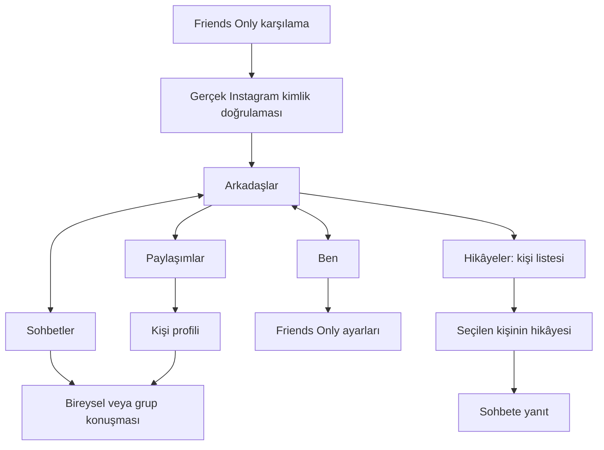

# Friends Only — arayüzü baştan tasarlama planı

Tarih: 18 Ekim 2026. Durum: tasarım önerisi; bu belgede tarif edilen yeni ekranlar henüz uygulanmadı veya cihazda doğrulanmadı. Bu çalışma APK üretmez.

## 1. Ürün kararı

Friends Only, takip ettiğin insanların paylaşımlarına, hikâyelerine ve mevcut sohbetlerine bilinçli olarak ulaşabileceğin sakin bir uygulama olacak. İlk bakıştaki kimliği kendi adı, tipografisi, yerleşimi ve gezinmesiyle oluşacak. Sadece Instagram'ın renklerini değiştirmek yeterli sayılmayacak.

Buradaki “arkadaşlar”, Instagram'da takip ettiğin hesaplar anlamına gelir. Karşılıklı arkadaşlık, telefon rehberi veya Instagram Yakın Arkadaşlar listesi anlamına gelmez. Yeni bir sosyal ağ, ayrı bir arkadaş listesi veya bağımsız mesajlaşma altyapısı kurmuyoruz.

Temel tasarım ilkeleri:

- İnsan adı ve içerik önce gelir; izlenme, takipçi, beğeni sayıları ve keşfet çağrıları görsel hiyerarşinin merkezinde olmaz.
- Kullanıcı paylaşım veya sohbet açmayı kendisi seçer. Reels'e götüren dokunma ve kaydırma yolları bulunmaz.
- Fotoğrafların ve videoların kendi renkleri, oranları ve içeriği korunur. Arayüzü sadeleştirmek için kullanıcı medyasına filtre uygulanmaz.
- Dikkat çeken kırmızı sayaçlar, hikâye halkaları, promosyonlar, yapay zekâ önerileri, seri rozetleri ve dekoratif animasyonlar kullanılmaz.
- Raporlama, engelleme, hesap güvenliği, çıkış ve gerekli yasal bilgiler erişilebilir kalır.
- Mevcut isteğin doğrultusunda akış videoları bitince aynı videoyu tekrarlar; basılı tutunca 2×, bırakınca normal hız hedefi korunur. Başka bir videoya otomatik geçiş yapılmaz. Bunların yeni tasarımda cihaz testi gerekir.

## 2. Tasarım yönü: sakin bir kişisel günlük ve yazışma alanı

### Görsel sistem

| Öğe | Planlanan karar |
| --- | --- |
| Açık tema | Sıcak kırık beyaz `#F8F7F4`, yüzey `#EDEEE9`, ana yazı `#242B27` |
| Koyu tema | Kömür yeşili `#151A17`, yüzey `#202722`, ana yazı `#F2F3EE` |
| Vurgu | Tek, koyu ve düşük doygunlukta yeşil; örneğin açık temada `#344D43` |
| Tipografi | Lisansı paketlenmek üzere Manrope önerisi; ana başlık 26 sp, bölüm 20 sp, içerik 16 sp, yardımcı metin 14 sp. Henüz font eklenmedi. |
| Yerleşim | 4/8 dp aralık sistemi, telefonda yaklaşık 20 dp dış boşluk, içerikler arasında net dikey mesafe |
| Yüzeyler | Çoğunlukla düz; gereksiz kart, gölge, gradyan, cam etkisi ve iç içe kutu yok |
| Köşeler | Düğmelerde yaklaşık 8 dp, avatarlarda 10–12 dp yuvarlatılmış kare |
| Düğmeler | En az 48 dp dokunma alanı; dolu düğme yalnızca ekranın esas eylemi için, diğerleri metin veya sade simge |
| Simgeler | Az sayıda, aynı çizim dilinde özgün simge. Instagram'ın kamera/kalp/kâğıt uçak gezinme sırası kullanılmaz. |
| Hareket | Dekoratif hareket yok; yalnızca gerekli dokunma geri bildirimi ve anlaşılır Android geçişleri |
| Marka | Friends Only yazısı ve kendi simgemiz; yeni ad seçilirse tek bir marka tanımından değiştirilebilir |

Renklerin bir kısmı mevcut yerel temamızla uyumludur. Asıl farkı yeni ekran yerleşimleri, içerik hiyerarşisi, gezinme ve bileşenler oluşturacak. Arayüz metinlerinin kontrastı ayrıca ölçülecek; renk tablosu tek başına erişilebilirlik kanıtı değildir.

### Ana gezinme

Alt bölümde üç yazılı hedef olacak: **Arkadaşlar · Sohbetler · Ben**. Aktif hedef koyu yazı ve ince bir işaretle belli olacak. Büyük renkli seçili kapsüller ve profil fotoğraflı gezinme kullanılmayacak.

Arkadaşlar ekranında iki yerel görünüm bulunacak: **Paylaşımlar / Hikâyeler**. Bunlar sade metin ve alt çizgiyle ayrılacak. Hikâyeler, Instagram'ın renkli yatay halka şeridinden ayrı bir kişi listesine taşınacak; bunun mevcut yerel bileşenlerle güvenli uygulanabilirliği ayrıca araştırılacak.

## 3. Ekran ekran tasarım

| Ekran | Görünecek yapı ve esas eylem | Kullanılmayacak yapı |
| --- | --- | --- |
| Karşılama | Friends Only, “Arkadaşlarına zaman ayır.”, kısa amaç açıklaması ve **Instagram ile bağlan** düğmesi. Altında hesabın Instagram üzerinden bağlandığını belirten kısa açıklama. | Pazarlama slaytları, büyük stok görseli, uygulamamıza ait parola formu |
| Giriş / doğrulama | Instagram'ın gerçek giriş, iki aşamalı doğrulama ve hesap kontrolü ekranları. Başarılı girişten sonra kendi ana ekranımıza geçiş. | Sahte giriş ekranı, şifre okuma, güvenlik veya yasal açıklamaları gizleme |
| Arkadaşlar / Paylaşımlar | Sade başlık, Paylaşımlar/Hikâyeler seçimi; kişi adı, küçük kare avatar, zaman, özgün medya, açıklama. Eylemler metin ağırlıklı: **Beğen · Yorumlar**; diğer işlemler küçük menüde. | Üstte Instagram araç çubuğu, renkli Story halkaları, büyük etkileşim sayaçları, önerilen hesaplar, Reels/Keşfet/gezinme kısayolları |
| Arkadaşlar / Hikâyeler | Hikâyesi olan takip edilen kişiler: kare avatar, ad, okunmamış durumu için küçük nötr işaret. Kişiyi kullanıcı açar. Sıralama mevcut verinin desteklediği şekilde açıklanır. | Gökkuşağı çemberler, yanıp sönme, önerilen kişiler, doğrulanmamış yeni sıralama iddiası |
| Hikâye izleme | Medya, kişi adı, kapat/geri, gerekli ilerleme göstergesi ve **Yanıtla**. Hedef: seçilen kişinin hikâyeleri bitince listeye dönmek. | Reels'e geçiş, başka hesaplara zorunlu devam, keşfet önerileri. Yeni bitiş davranışı uygulanabilirlik kontrolüne bağlı. |
| Sohbetler | “Sohbetler” başlığı, mevcut konuşmalarda arama destekleniyorsa arama; kişi/grup adı, son mesaj ve zaman. Okunmamış konuşmada en fazla sade bir işaret. | Meta AI, Notes, kanal ve kişi önerileri, çevrimiçi olmayı teşvik eden görsel alanlar, kırmızı sayı yığınları |
| Konuşma | Kişi/grup başlığı, sade mesaj balonları, sabit yazma alanı, gönder düğmesi. Medya/ses ekleri desteklendiği ölçüde küçük “+” menüsünde. Grup ayrıntıları başlıktan açılır. | Gereksiz çıkartma veya efekt rafları, sohbet içi promosyonlar, varsayılan açık ek paneller |
| Ben | Kendi adın, avatarın, kısa profil bilgisi; **Paylaşımlarım**, **Takip ettiklerim**, **Ayarlar**. Kendi içeriklerin için sakin, satır temelli görünüm hedefi. | Takipçi/popülerlik panosu, profesyonel hesap promosyonları, Threads/Meta geçişleri, Instagram'a özgü çok sekmeli profil araçları |
| Kişi profili | Ad, avatar, kısa bilgi, takip durumu ve **Mesaj yaz**; paylaşımlara sade erişim. Takibi bırak/engelle/şikâyet ikincil menüde kalır. | Önerilen benzer hesaplar ve popülerlik odaklı büyük sayaçlar |
| Ayarlar | Görünüm: sistem/açık/koyu hedefi; sadece takip edilenler filtresinin durumu ve açıklaması; video kontrolleri bilgisi; hesap/gizlilik/çıkış; sürüm ve sorun bildirme bilgisi. | Instagram/Meta promosyon menüsü, Keşfet/Reels'i geri açan seçenekler, sayfalarca özellik anahtarı |

Paylaşım oluşturma ana gezinmede yer almayacak. Hikâye paylaşma, yorumlar, kaydedilmiş içerik veya diğer ikincil işlemler için yeni ekranlar uydurulmayacak; gerekli ve desteklenen eylemler bağlamsal menülerde değerlendirilecek. Kullanıcının başkasının profilindeki bir videoya dokunması, önceden istendiği gibi Reels görüntüleyicisini açmayacak; alternatif bir tam ekran oynatıcı bu planın kapsamına eklenmiyor.

## 4. “Sadece takip ettiklerim” davranışı

- Ana akışa kabul şartı, mevcut yerel veride gönderi sahibinin takip edildiğinin açıkça belirtilmesidir. Reklam veya öneri olduğunu gösteren mevcut işaretler ayrıca değerlendirilir.
- Durumu belirsiz bir gönderi “arkadaş gönderisi” diye gösterilmez. Bunun sonucu boş veya kısa akış olabilir; kullanıcıya doğru açıklama gösterilir.
- Hikâye ve sohbet filtreleri akış filtresiyle aynı sanılmaz. Hikâyeler için ayrı kaynak ve takip bilgisi doğrulaması gerekir.
- Mevcut filtre yeni takip listesi indirmez; özel API çağrısı veya otomatik tarama eklemeyeceğiz.
- “Tamamı kronolojik”, “hiçbir gönderi eksik değil” veya “her yerde yalnızca takip edilenler” iddiası, gerçek veri ve cihaz testi olmadan kullanılmaz.
- Boş akışta “Gösterilebilen paylaşım yok. Takip bilgisi doğrulanamayan içerikler gizlenebilir.” gibi doğru bir açıklama yer alır. Yenileme sunulur; önerilere yönlendirilmez.
- “Hepsini gördün” gibi bitiş mesajı yalnızca gerçek akış sonu doğrulanabiliyorsa kullanılır. Keyfî gönderi sayısından sahte bitiş üretilmez.

## 5. Mevcut APK ile uygulanabilirlik sınırı

Bu proje şu anda Instagram'ın yerel APK'sına sınırlı ve sürüme bağlı yamalar uyguluyor. Kendi bağımsız istemcimiz veya kendi sunucumuz değil. Yeni marka ve tasarım, Instagram altyapısı, veri işlemesi ve koşullarıyla teknik ilişkiyi ortadan kaldırmaz; bu ilişki hesap ve gizlilik bilgisinde doğru anlatılacak.

Kod incelemesi: `QuietChrome.java` kendi başlığını ve üç alt sekmeyi giydiriyor; içerik listelerinin içine genel tarama yapmıyor. `FocusHooks.java` kendi küçük ayar penceremizi açıyor. `QuietThemePatch.kt` belirli yerel tema renklerini değiştiriyor. Akış satırları, hikâye listesi, mesaj balonları ve profil düzeni henüz kendi ekranlarımız değil.

| Alan | Bugünkü kanıt | Tasarım uygulamasından önce gereken |
| --- | --- | --- |
| Ad/simge, ana başlık, üç sekme, sınırlı renkler, küçük ayarlar | Kaynakta mevcut yama noktaları var. Mevcut görünüm yeni tasarımın tamamlandığı anlamına gelmez. | Yeni ölçü/tema/erişilebilirlik düzeni ve gerçek cihaz doğrulaması |
| Karşılama ve oturumdan ana ekrana yönlendirme | Önerilen karşılama henüz yok. | Güvenli oturum durumu ve Activity akışı; giriş/challenge davranışını değiştirmeden ispat |
| Hikâyeleri ayrı kişi listesine taşıma | Mevcut üst hikâye alanı özgün yerel bileşen. | Kaynak, bağlama ve gezinme yollarını belirleme; kendi liste düzeni mümkün mü denemesi |
| Gönderi satırları ve eylemler | Özgün yerel içerik/oynatıcı kullanılıyor. | Dar kapsamlı düzen denemesi; tıklama, yorum, medya yaşam döngüsü ve geri dönüş testi |
| Sohbet listesi, konuşma, grup ayrıntıları | Özgün Direct bileşenleri. | Her görünüm için ayrı yama noktası; klavye, gönderim, grup ve ekleri bozmayan prototip |
| Kendi/başkasının profili | Yalnızca belirli kendi-profil ayar yolları değiştirilmiş. | Profil düzeni ve listesi için ayrı teknik inceleme; başka kişinin engelle/şikâyet işlemlerini koruma |
| Tema/font ve ayarların genişletilmesi | Kısmi tema var; tüm uygulama için yeni font/görünüm tercihi kanıtlanmadı. | Kaynak türlerini koruyan tema; eksik görünüm ve lisans kontrolü |

Tüm ekranların tamamen yeniden çizilebileceğini henüz söylemiyoruz. Ekran başına küçük bir teknik deneme yapılacak. Güvenli erişilemeyen yüzey “tamamlandı” sayılmayacak; sınırlama ve uygulanabilir alternatif tasarım açıkça belirtilecek. WebView'e geri dönmek, özel API kullanmak veya çok sayıda görünümü körlemesine örtmek varsayılan çözüm olmayacak.

Önceki açılış çökmesinin tekrarlanmaması için tema alanlarının kaynak türleri korunacak: renk kaynağı bekleyen alanlara düz renk değeri yazılmayacak. Mevcut çıktı doğrulaması kaldırılmayacak. Geniş görünüm ağacı taramaları ve her karede çalışan arayüz yamaları eklenmeyecek.

## 6. Erişilebilirlik ve durumlar

- Android/Samsung S24+ hedefi: sistem çubukları, hareket alanı ve klavye boşlukları doğru ele alınır; iPhone görünümü çizilmez.
- Etkileşim alanı en az 48 dp; yazı boyutu artınca yerleşim büyür. Yüzde 200 yazı ölçeği, TalkBack etiketleri, odak sırası ve geri tuşu kontrol edilir.
- Normal metinde en az 4,5:1 kontrast hedefi; seçili/okunmamış/hata durumları sadece renkle anlatılmaz.
- Türkçe, İngilizce ve Almanca uzun metinler için alan bırakılır. Büyük metinlerde içerik veya düğme saklanmaz.
- Her ana ekran için yükleniyor, boş, bağlantı hatası ve yeniden dene durumları tasarlanır. Yapay gecikme, parlayan yükleme animasyonu veya sahte ilerleme gösterilmez.
- Gönderilemeyen mesaj gönderilmiş görünmez; yeniden denemek mükerrer mesaj oluşturmamalıdır. Yerel gönderim durumu korunur.
- Oturumun sona ermesi veya hesap kontrolü gerektiğinde kullanıcı gerçek Instagram doğrulamasına yönlendirilir; hata dekoratif katmanla kapatılmaz.

## 7. Tasarım ve geliştirme sırası

1. **Bu plan:** ürün sınırları, ekran listesi, tek görsel sistem ve teknik belirsizlikler. Yalnızca planlama dokümanı; uygulama değişmez.
2. **Yerleşim taslakları:** bütün akış için düşük detaylı ekranlar. Önce karşılama, Arkadaşlar, Hikâyeler, Sohbetler, konuşma, Ben; sonra kişi profili, ayarlar ve durumlar. Gezinme ve geri dönüş yolları bu aşamada netleşir.
3. **Görsel tasarım:** Taste mobil yönergeleriyle aynı Android çerçevesinde, okunabilir ölçekte ayrı ekran görselleri. Önce altı ana ekran, ardından hikâye izleyici/ayarlar ve koyu tema eşleri. Onlarca ekranı okunamaz tek kolaja sıkıştırmayız. Taslak içeriklerin örnek olduğu belirtilir; özel mesajlar veya gerçek hesap verileri kullanılmaz.
4. **Teknik denemeler:** mevcut başlık/sekme/ayarlar gibi erişilebilen alanlardan başlanır. Akış satırı, hikâyeler, Direct ve profil için ayrı uygulanabilirlik kararı alınır. Görsel taslakla yerel bileşen uyuşmuyorsa karar kaydedilir ve tasarım güncellenir.
5. **Kademeli uygulama:** ana iskelet → akış/hikâyeler → sohbetler → profil/ayarlar → hata/erişilebilirlik. Her adımda önceki çalışan davranışlar korunur ve ilgili derleme/doğrulama kontrolleri çalışır.
6. **Cihaz doğrulaması:** Android 17 / One UI 9 üzerinde gerçek oturum, hikâye yanıtı, bireysel/grup mesajı, video, geri gezinme ve farklı temalar. Otomatik APK derlemesi bunların yerine geçmez.

Henüz uygulanmamış ekranlara sürüm numarası veya teslim tarihi atanmaz. Bu plan tasarım hedefini belirler; geniş APK arayüz değişikliğinin süresi teknik denemelerden sonra değerlendirilebilir.

## 8. Tamamlanma ölçütleri

- Giriş sonrası ana ekranın yerleşimi, gezinmesi ve eylem dili özgün olur; yalnızca başlık/logo/renk değişimi yeterli değildir.
- Instagram'a ait alt simge dizisi, renkli hikâye şeridi ve keşif/popülerlik panoları yeni ana ekranlarda bulunmaz. Gerçek giriş, güvenlik ve gerekli açıklamalar istisnadır.
- Marka yazısı gizlenmiş taslaklarla yapılacak kısa kullanıcı kontrolünde neyin kullanılabildiği anlaşılır; Instagram'a benzetme geri bildirimi toplanır. Bu test henüz yapılmadı.
- Kullanıcı bir arkadaşının hikâyesine, mevcut konuşmasına veya grup sohbetine kısa ve anlaşılır bir yoldan ulaşır.
- Reels'e dokunma, sağ/sol kaydırma, profil videosu ve geri gezinme ile kaçış yolları ayrıca denenir. Yeni tasarım eski kısıtları geri açmaz.
- Takip edilmeyen örnek gönderiler gösterilmez; belirsiz veri açıklaması görünür. Kronolojik veya eksiksiz akış iddiası ayrı kanıt ister.
- Normal video gönderileri kaybolmaz; 2× basılı tutma, bırakma/iptal ve tekrar oynatma ayrı doğrulanır. Hikâye ve mesaj medyası yanlışlıkla bu kontrollerden etkilenmez.
- Giriş, iki aşamalı doğrulama, çıkış, grup mesajı, engelleme ve şikâyet erişilebilir kalır.
- Uygulamamıza ait parola formu, yeni takip altyapısı, analitik veya mesaj/oturum verisini toplayan hizmet eklenmez. Özgün Instagram altyapısının veri işlemesi hakkında aksi iddiada bulunulmaz.
- Derleme çıktısı, otomatik kontroller ve fiziksel cihaz sonuçları ayrı kaydedilir; görsel taslak “çalışıyor” kanıtı sayılmaz.

## Kullanılan Taste yönergeleri

- [minimalist-ui](../.agents/skills/minimalist-ui/SKILL.md): sıcak nötr renkler, güçlü tipografi, sade yüzeyler.
- [redesign-existing-projects](../.agents/skills/redesign-existing-projects/SKILL.md): mevcut projeyi inceleme, ekran/durum denetimi ve işlevleri koruma.
- [imagegen-frontend-mobile](../.agents/skills/imagegen-frontend-mobile/SKILL.md): sonraki görsel aşamada Android ölçeği, tutarlı çok ekranlı tasarım ve okunabilirlik.

Kullanıcının **önce planlama**, **minimalizm** ve **dikkat dağıtmama** talepleri belirleyicidir. Bu nedenle skill'lerdeki web pazarlama düzenleri, dekoratif dokular/gradyanlar, giriş animasyonları veya kullanıcı medyasını renklendirme önerileri bu projeye taşınmaz. Bu aşamada görsel üretim ve arayüz kodlama yapılmamıştır.
